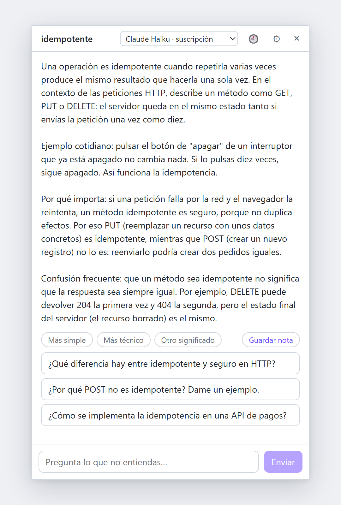

<div align="center">


# Xplainer

**Select any text on Windows or Linux, press <kbd>Alt</kbd>+<kbd>X</kbd>, and get a short, clear explanation, then keep asking.**

A tray app that turns any word, paragraph, piece of code or error message into a lesson, with your own AI subscription or a free local model.

[](#install)
[](https://tauri.app)
[](LICENSE)

[Install](#install) · [Features](#features) · [Models](#choose-a-model) · [Privacy](#privacy-and-security) · [Build from source](#build-from-source)

<picture>
  <source media="(prefers-color-scheme: dark)" srcset="docs/screenshot-dark.png" />
  
</picture>

</div>

> [!NOTE]
> Explanations are written in **Spanish**. The interface is in Spanish too.

## Why

Reading documentation, a paper or a code review, you hit a word you don't know. Searching for it means leaving what you were reading, opening a browser and wading through results written for someone else.

Xplainer stays out of the way in the tray. Select the text, press <kbd>Alt</kbd>+<kbd>X</kbd>, and a small popup next to your cursor explains it at the right level, using where you selected it (the app, the web page and the text around it) to pick the right meaning.

## Features

- **Explains anything you can select.** It adapts the structure to what you selected: a term gets a definition, an everyday analogy and a common confusion; code is walked through step by step; an error gets its likely cause and how to check it.
- **Text you can't select, too.** Press <kbd>Win</kbd>+<kbd>Shift</kbd>+<kbd>Z</kbd>, snip part of the screen (an image, a video, a locked PDF) and Xplainer reads it with the OCR built into Windows. Windows only.
- **Change the level in one click.** *Más simple*, *Más técnico* and *Otro significado* rephrase the last answer without typing.
- **Go deeper without losing your place.** Select a word inside an answer to explain it as a new level. A trail (`TCP › handshake › SYN`) takes you back to any level.
- **Suggested follow-ups.** Every answer ends with three questions you can ask with one click, or type your own.
- **Save it as a note.** Export the conversation as a Markdown file to any folder, such as an Obsidian vault.
- **Searchable history.** Conversations are kept on your computer, searchable without caring about accents or case, and you can pick one up where you left it.
- **Your models, no API bills.** Use Claude or ChatGPT through the subscription you already have, or a free model that runs on your computer with Ollama.
- **Guided first run.** The first time, Xplainer asks which AI to use and shows what each one still needs: sign in to Claude or ChatGPT with their own login window, or install Ollama and download a free model sized for your RAM. From then on it just uses your choice; change it in ⚙ → *Elegir otra IA*.

## Install

### Windows

1. Download `Xplainer_0.2.0_x64-setup.exe` from the [latest release](https://github.com/Juaigles/Xplainer/releases/latest).
2. Run it. It installs for your user only, without admin rights.
3. The installer is not code-signed yet, so Windows SmartScreen warns you the first time: click **More info → Run anyway**.
4. Xplainer starts in the system tray. Select some text anywhere and press <kbd>Alt</kbd>+<kbd>X</kbd>. The first time, choose which AI explains.

To start it with Windows, right-click the tray icon and tick **Iniciar con Windows**. It is off by default. To uninstall it, use **Settings → Apps** in Windows.

### Linux

Xplainer's core works on Linux: explain the selection, follow-up questions, the three AIs, notes, history and the window context. There is no snipping with OCR.

1. Download the `.deb` (Debian, Ubuntu and derivatives) or the `.AppImage` (most other distributions) from the [latest release](https://github.com/Juaigles/Xplainer/releases/latest).
2. Install the `.deb` with `sudo apt install ./Xplainer_0.2.0_amd64.deb`, or make the AppImage executable (`chmod +x`) and run it.
3. Xplainer starts in the system tray. GNOME needs the *AppIndicator* extension to show tray icons.

How you trigger it depends on your desktop session:

- **X11:** select some text and press <kbd>Alt</kbd>+<kbd>X</kbd>, as on Windows.
- **Wayland** (the default on recent Ubuntu and Fedora): apps cannot register global shortcuts there. Open your desktop's keyboard settings, add a custom shortcut (for example <kbd>Alt</kbd>+<kbd>X</kbd>) and make it run `xplainer --explain` (with the AppImage, the AppImage's path followed by `--explain`). If Xplainer is not running, the shortcut starts it and explains the selection.

To start it with your session, tick **Iniciar con la sesión** in the tray menu.

Xplainer does not update itself yet: to update, download the new version and install it over the old one.

## Choose a model

Pick the model in the popup's dropdown. It only lists the ones that work on your computer and remembers your choice.

| Model | Cost | What you need |
| --- | --- | --- |
| **Ollama models** (local) | Free | [Ollama](https://ollama.com) with any chat model. The first-run assistant sets it up for you. |
| **Claude Haiku** | Your Claude plan's usage limits | [Claude Code](https://code.claude.com) installed with the native installer and signed in. |
| **GPT-5.6 Luna** | Your ChatGPT plan's Codex limits | [Codex CLI](https://developers.openai.com/codex) signed in with your ChatGPT account. |

Local models need no internet and no account, but without a dedicated GPU, big models are slow: the assistant recommends `qwen3:4b-instruct` (2.5 GB) with 10 GB of RAM or more, and `qwen3:1.7b` (1.4 GB) otherwise. Xplainer loads the chosen local model as soon as you pick it, so it is ready by the time you ask.

## Shortcuts

| Keys | Action |
| --- | --- |
| <kbd>Alt</kbd>+<kbd>X</kbd> | Explain the selected text. Inside the popup, explain the selected word one level deeper. |
| <kbd>Win</kbd>+<kbd>Shift</kbd>+<kbd>Z</kbd> | Snip part of the screen and explain the text in it (Windows only). |
| <kbd>Esc</kbd> | Hide the popup. |

Launching Xplainer again from the Start menu just opens the popup of the copy already running. To quit, right-click the tray icon and choose **Salir**.

## Privacy and security

- **No API keys.** Xplainer never asks for or stores credentials. Claude and Codex run through their own command-line tools, signed in with your account; Xplainer removes API keys from their environment, so they always use your subscription instead of pay-per-use billing.
- **Selected text is untrusted.** It may contain instructions written by someone else. Claude runs without tools, MCP servers or your personal settings; Codex runs read-only, without a shell, connectors or web search.
- **History stays on your computer**, in `%APPDATA%\com.kiook.xplainer\history.json` (on Linux, `~/.local/share/com.kiook.xplainer/history.json`). You can pause it, delete single entries or all of it, and list words that block saving when they appear in the source window's title. By default it skips password managers, banks and private browsing windows.
- **Window context you can check.** With <kbd>Alt</kbd>+<kbd>X</kbd>, Xplainer also sends the app, the page address (without query strings, ids or tokens) and up to 1,500 characters around the selection, only with the first question. *Contexto*, above the answer, shows exactly what was sent. Turn it off in ⚙ → *Usar el contexto de la ventana*; windows in the exclusion list never send it.
- **No telemetry.** With a local Ollama model, nothing leaves your computer.

## How it works

1. A global shortcut waits for you to release the keys, simulates <kbd>Ctrl</kbd>+<kbd>C</kbd>, reads the clipboard and puts your previous clipboard text back.
2. Meanwhile, Windows UI Automation reads what surrounds the selection in the source window ([`src-tauri/src/screen_context.rs`](src-tauri/src/screen_context.rs)).
3. The popup sends the text and that context to the chosen model with a teaching prompt, and streams the answer as it arrives.
4. The conversation is kept as plain text, so you can switch models halfway through.

On Linux nothing is copied. The accessibility bus (AT-SPI) gives the active window's title, the selected text and what surrounds it ([`src-tauri/src/screen_context/linux.rs`](src-tauri/src/screen_context/linux.rs)); on X11 the primary selection completes it.

The native side is Rust ([`src-tauri/src/lib.rs`](src-tauri/src/lib.rs)); the popup is Vue 3 and TypeScript ([`src/App.vue`](src/App.vue)). [`AGENTS.md`](AGENTS.md) records the design decisions and their reasons (in Spanish).

## Build from source

Requirements:

- Windows 10 or 11, or Linux
- [Node.js](https://nodejs.org) 22 or later
- [Rust](https://rustup.rs): on Windows, the `stable-msvc` toolchain
- On Windows, Visual Studio Build Tools with the C++ workload and the Windows SDK
- On Linux, the [system libraries Tauri needs](https://v2.tauri.app/start/prerequisites/#linux) (WebKitGTK 4.1, AppIndicator, librsvg...)

```bash
npm install
npm run tauri dev     # run in development
npm run tauri build   # create the installer in src-tauri/target/release/bundle/ (nsis/, or deb/ and appimage/)
npm run test:all      # frontend (Vitest) and native (cargo test) tests
```

Close the installed Xplainer before running a development build: both use the same shortcuts. [`TESTING.md`](TESTING.md) lists the acceptance criteria, the test that covers each one, and the smoke test of the final executable.

## Known limitations

- On Linux:
  - No snipping with OCR.
  - On Wayland there is no built-in shortcut: you bind `xplainer --explain` yourself, and the popup may not open next to the cursor.
  - The window context and the exact selection only come from apps that publish their accessibility tree. GTK and Qt apps do. Chrome, Firefox and Electron apps (VS Code) only when the desktop's accessibility is on (`gsettings set org.gnome.desktop.interface toolkit-accessibility true`, then restart the browser), which makes them use more memory. Xplainer never turns it on for you.
  - Without that, on X11 Xplainer uses the primary selection, which may be an older selection; on GNOME Wayland it may get no text and the popup opens empty for you to type. When an app does say that nothing is selected, the primary selection is never sent.
  - The history's exclusion list needs the window title, which also comes from the accessibility bus.
- While Xplainer runs, <kbd>Alt</kbd>+<kbd>X</kbd> no longer reaches other apps; in Word and Outlook it normally converts a Unicode code into its character.
- In a terminal with nothing selected, the simulated <kbd>Ctrl</kbd>+<kbd>C</kbd> interrupts the running process.
- Only plain text is restored to the clipboard: rich text comes back without formatting, and files or images copied before are lost.
- The OCR can confuse similar characters (`l` and `I`) or drop lone symbols in code.
- Codex always reads your global `~/.codex/AGENTS.md`; it has no option to skip it.

## Contributing

Issues and pull requests are welcome. For anything bigger than a fix, please open an issue first to talk it over. [`AGENTS.md`](AGENTS.md) explains how the code is organised and the decisions behind it, and `npm run test:all` should pass before a pull request.

## License

[MIT](LICENSE) © 2026 Jota Iglesias

Xplainer is an independent project, not affiliated with Anthropic, OpenAI or Ollama.
